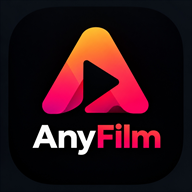

# AnyFilm

  

  <strong>The Ultimate All-in-One Entertainment Streaming Client for Android</strong>

  
  
  
  

---

**AnyFilm** is a next-generation Android entertainment hub built with **Jetpack Compose**, **Material 3**, and **Media3 ExoPlayer**. It unites multiple streaming providers, OTT platforms, live TV, sports broadcasts, and an advanced segmented download engine into a unified, silky-smooth, ad-free mobile experience.

---

## 🌟 Key Features

### 🎬 Multi-Source Provider Ecosystem
* **Multi-Provider Switching**: Effortlessly toggle between **MovieBox**, **Castle**, and **AniFam** directly from settings with zero configuration.
* **Regional & Localization Controls**: Full regional support (Indonesia, United States, United Kingdom, India, and more) to access region-tailored catalogues.
* **Local Micro-Engine**: Built-in on-device proxy server that handles dynamic token handshakes, feed routing, and encrypted streaming endpoints seamlessly.

### 📺 OTT Hub & Category Discovery
* **Unified OTT Explorer**: Browse trending and popular titles curated across **Netflix, Prime Video, Disney+, Apple TV+, HBO Max, Crunchyroll, and MX Player**.
* **Personalized Category Management**: Fully customize, reorder, or toggle genre and category rows on your Home screen.
* **Rich Search & Filmography**: Instant search with trending keywords, category filters, actor filmographies, and multi-provider results.

### 📡 Live TV & Live Sports
* **Live TV Channels**: High-availability HLS/DASH streaming across categories: *Sports, Movies, Entertainment, News, Kids, Music, and Documentaries*.
* **Live Sports Hub**: Up-to-the-minute sports match listings, event schedules, and direct low-latency live streams for football, cricket, basketball, and more.

### ⚡ Advanced Media3 Video Player
* **Intuitive Touch Gestures**: Swipe vertical left/right for smooth brightness and volume control; horizontal swipe for high-precision time seeking.
* **Resolution & Stream Control**: Switch between multiple stream qualities (360p, 480p, 720p, 1080p, and 4K UHD).
* **Multi-Audio & Dubs**: Seamless switching between native audio tracks and localized dubs (Hindi, English, etc.).
* **Canvas-Rendered Subtitles**: Native anti-aliased canvas subtitles with crisp typography and sync offset adjustment.
* **Cast & PiP**: Full Picture-in-Picture (PiP) multitasking and Google Cast / DLNA background streaming support.

### 📥 High-Speed Segmented Download Engine
* **Parallel Downloads**: Concurrently download multiple episodes and movies (customizable 1–10 simultaneous downloads).
* **Segmented Connections**: Multi-thread chunked connection accelerator (1–32 connections) for maximum bandwidth saturation.
* **Offline Library**: Integrated in-app downloads library with background progress notifications, pause/resume, and instant offline playback.

### 🎨 Design & Personalization
* **Dark Cinematic Theme**: Deep OLED-optimized dark theme with accent customizations (Cinematic Red, Obsidian, Amber, Neon Emerald).
* **Watchlist & Millisecond History**: Automatically saves playback down to the exact millisecond using Room Database for uninterrupted resumption.

---

## 🛠️ Technology Stack

| Layer | Technologies |
|---|---|
| **UI & Architecture** | 100% Kotlin, Jetpack Compose, Material 3, MVVM + Coroutines & Flow |
| **Media & Playback** | AndroidX Media3 ExoPlayer, Canvas Subtitle Engine, Picture-in-Picture |
| **Networking & HTTP** | Retrofit 2, OkHttp 4, Local In-App HTTP Proxy Server (`LocalMovieBoxServer`) |
| **Local Persistence** | AndroidX Room Database, AndroidX Preferences DataStore |
| **Image Loading** | Coil Compose |
| **Security & Optimization** | R8 Minification, Resource Shrinking, Runtime Integrity Checks |

---

## 🚀 Setup & Installation

1. Download the latest release APK from the [Releases](https://github.com/solo12345689/AnyFilm/releases) page.
2. Enable *"Install from unknown sources"* in your Android device settings if prompted.
3. Open the app and enjoy!

---

## 📊 Star History

<a href="https://www.star-history.com/?repos=solo12345689%2FAnyFilm&type=date&legend=top-left">
 <picture>
   <source media="(prefers-color-scheme: dark)" srcset="https://api.star-history.com/chart?repos=solo12345689/AnyFilm&type=date&theme=dark&legend=top-left" />
   <source media="(prefers-color-scheme: light)" srcset="https://api.star-history.com/chart?repos=solo12345689/AnyFilm&type=date&legend=top-left" />
   
 </picture>
</a>

---

## 📄 License

This project is licensed under the [MIT License](LICENSE).  
You are free to use, fork, and modify this project, provided that proper credit and copyright notice to the original creator (**solo12345689**) are included in all copies or substantial portions of the software.

---

  Made with ❤️ by <a href="https://github.com/solo12345689">solo12345689</a>

